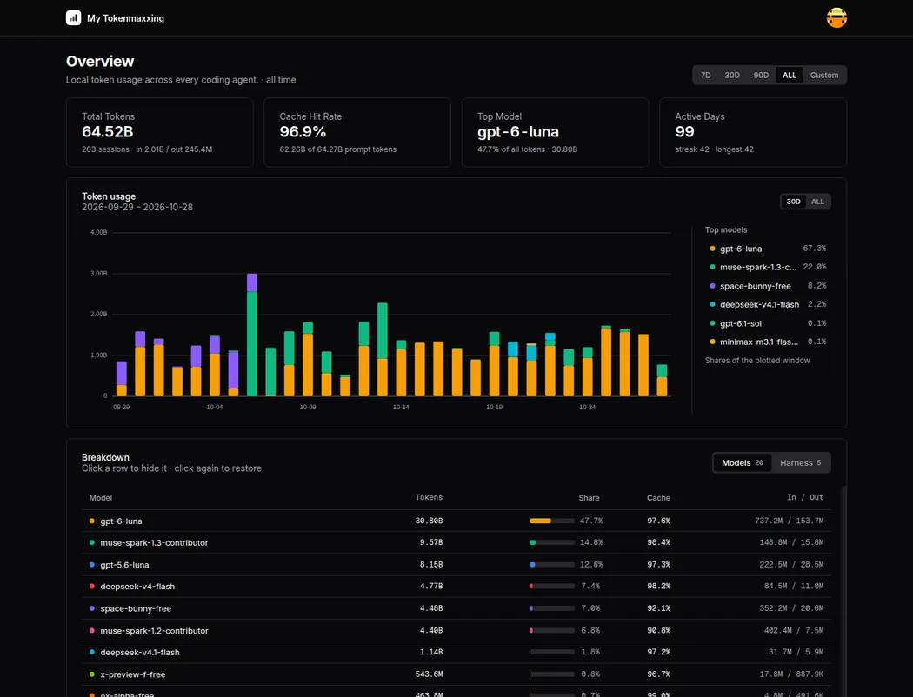

# My TokenMaxxing

Local dashboard for LLM token usage across coding agents. Collects from 11 sources, shows one page. No build step, no cost tracking.



## Quick start

```bash
bun install
bun run server/index.js
# → http://localhost:3642
```

Needs [Bun](https://bun.sh) 1.3+ or Node.js 24+, plus ccusage for the Codex-family sources.

## What it does

- **Aggregates** Codex, OpenCode, Claude, Gemini, Copilot, pi (via ccusage) plus OMP, ZCode, Reasonix, OpenGrok, and DSH local logs into one daily summary
- **Displays** a stacked token chart with per-day tooltips, period filters (7D / 30D / 90D / ALL / custom), per-model and per-harness breakdowns with cache hit rates
- **Profile** via `?name=…&avatar=…` or the in-page Edit button (browser-local)

## Data sources

| Source | Read from | Status |
|--------|-----------|--------|
| Codex, OpenCode, pi | `ccusage <name> daily` | ✅ |
| Claude, Gemini, Copilot | `ccusage <name> daily` | ⚠️ needs setup |
| OMP | `~/.omp/agent/sessions/*.jsonl` | ✅ |
| ZCode | `~/.zcode/cli/db/db.sqlite` | ✅ (Bun, or Node 22.5+ via node:sqlite) |
| Reasonix | `%APPDATA%/reasonix/projects/*/sessions/*.telemetry.json` | ✅ |
| OpenGrok | `$OPENGROK_HOME/sessions/**/usage.json` (else `~/.opengrok`) | ✅ |
| DSH | `$DSH_HOME/storages/session_projcache/sessions/*.json` (else `~/.dsh`) | ✅ session totals attributed to the last-prompt day (daily spikes are approximate) |

Reader spec: `token-reading-logic.md` (Japanese).

## Layout

```
server/index.js            express server (API + static files)
server/data-fetcher.js     collectors + aggregation
server/refresh-dashboard.js  background aggregation worker
public/index.html          dashboard UI (shadcn-style, zero dependencies)
public/tmx.js              shared dashboard helpers
```

## License

MIT
